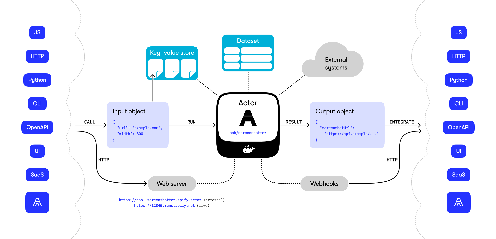
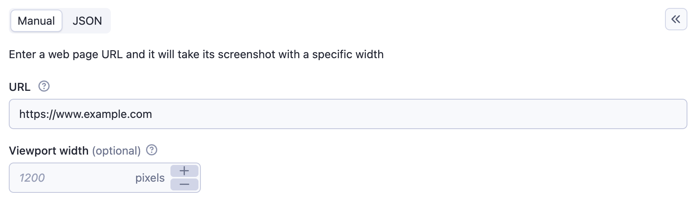

# The Web Actor Programming Model Whitepaper

**This whitepaper describes a new concept for building serverless microapps called **_Actors_**,
which are easy to develop, share, integrate, and build upon.
Actors are a reincarnation of the UNIX philosophy
for programs running in the cloud.**

By [Jan Čurn](https://apify.com/jancurn),
[Marek Trunkát](https://apify.com/mtrunkat),
[Ondra Urban](https://apify.com/mnmkng), and the entire Apify team.

**Version 0.999 (February 2025)**

## Contents

<!-- toc -->

- [Introduction](#introduction)
  * [Background](#background)
  * [Overview](#overview)
  * [Apify platform](#apify-platform)
- [Basic concepts](#basic-concepts)
  * [Input](#input)
  * [Run environment](#run-environment)
  * [Output](#output)
  * [Storage](#storage)
  * [Integrations](#integrations)
  * [What Actors are not](#what-actors-are-not)
- [Philosophy](#philosophy)
  * [UNIX programs vs. Actors](#unix-programs-vs-actors)
  * [Design principles](#design-principles)
  * [Relation to the Actor model](#relation-to-the-actor-model)
  * [Why the name "Actor"](#why-the-name-actor)
- [Installation and setup](#installation-and-setup)
  * [Running on the Apify platform](#running-on-the-apify-platform)
  * [Node.js](#nodejs)
  * [Python](#python)
  * [Command-line interface (CLI)](#command-line-interface-cli)
- [Actor programming interface](#actor-programming-interface)
  * [Initialization](#initialization)
  * [Get input](#get-input)
  * [Key-value store access](#key-value-store-access)
  * [Push results to dataset](#push-results-to-dataset)
  * [Exit Actor](#exit-actor)
  * [Environment variables](#environment-variables)
  * [Actor status](#actor-status)
  * [System events](#system-events)
  * [Get memory information](#get-memory-information)
  * [Start another Actor](#start-another-actor)
  * [Metamorph](#metamorph)
  * [Attach webhook to an Actor run](#attach-webhook-to-an-actor-run)
  * [Abort another Actor](#abort-another-actor)
  * [Reboot an Actor](#reboot-an-actor)
  * [Actor web server](#actor-web-server)
  * [Standby mode](#standby-mode)
  * [Migration to another server](#migration-to-another-server)
  * [Charging money](#charging-money)
- [Actor definition files](#actor-definition-files)
  * [Actor file](#actor-file)
  * [Dockerfile](#dockerfile)
  * [README](#readme)
  * [Input schema file](#input-schema-file)
  * [Output schema file](#output-schema-file)
  * [Storage schema files](#storage-schema-files)
  * [Backward compatibility](#backward-compatibility)
- [Development](#development)
  * [Local development](#local-development)
  * [Deployment to Apify platform](#deployment-to-apify-platform)
  * [Continuous integration and delivery](#continuous-integration-and-delivery)
  * [Actorizing existing code](#actorizing-existing-code)
- [Sharing and publishing](#sharing-and-publishing)
  * [Monetization](#monetization)
- [Future work](#future-work)
- [Links](#links)

<!-- tocstop -->

## Introduction

This whitepaper introduces **_Actors_**,
a new language-agnostic model for building general-purpose
web computing and automation programs (also known as agents, functions, or apps).
The main goal for Actors is to make it easy for developers to build and ship reusable
software tools, which are easy to run, integrate, and build upon.
Actors are useful for building
web scrapers, crawlers, automations, and AI agents.

### Background

Actors were first introduced by [Apify](https://apify.com/) in late 2017,
as a way to easily build, package, and ship web scraping and web automation jobs to customers.
Over the years, Apify has continued to develop the concept and applied
it successfully to thousands of real-world use cases in many business areas,
well beyond the domain of web scraping.

Building on this experience,
we're releasing this whitepaper to introduce the philosophy of Actors
to other developers and receive your feedback on it.
We aim to establish the Actor programming model as an open standard,
which will help the community to more effectively
build and ship reusable software automation tools,
as well as encourage new implementations of the model in other programming languages.

The goal of this whitepaper is to be the North Star that shows what the
Actor programming model is and what operations it should support.
**But this document is not an official specification.**
The specification will be an OpenAPI schema of the Actor system interface,
to enable new independent implementations of both the client libraries and backend systems. This is currently a work in progress.

Currently, the most complete implementation of the Actor model is provided
by the Apify platform, with SDKs for
[Node.js](https://sdk.apify.com/) and
[Python](https://pypi.org/project/apify/),
and a [command-line interface (CLI)](https://docs.apify.com/cli).
Beware that the frameworks might not yet implement all the features of the Actor programming model
described in this whitepaper.

### Overview

Actors are serverless programs that run in the cloud.
They can perform anything from simple actions such as
filling out a web form or sending an email,
to complex operations such as crawling an entire website,
or removing duplicates from a large dataset.
Actors can persist their state and be restarted, and thus they can
run as short or as long as necessary, from seconds to hours, even infinitely.

Basically, Actors are programs packaged as Docker images,
which accept a well-defined JSON input, perform
an action, and optionally produce a well-defined JSON output.

Actors have the following elements:

- **Dockerfile** which specifies where the Actor's source code is,
  how to build it, and run it.
- **Documentation** in a form of a README.md file.
- **Input and output schemas** that describe what input the Actor requires,
  and what results it produces.
- Access to an out-of-the-box **storage system** for Actor data, results, and files.
- **Metadata** such as the Actor name, description, author, and version.

The documentation and the input/output schemas make it possible for people to easily understand what the Actor does,
enter the required inputs both in user interface or API,
and integrate the results of the Actor into their other workflows.
Actors can easily call and interact with each other, enabling the building of more complex
systems on top of simple ones.

<!-- ASTRO: <Diagram horizontal={illuDiagramHoriz} vertical={illuDiagramVert} alt="Actor drawing" /> -->



<!-- Image sources:
  https://docs.google.com/presentation/d/1nDgrI0p2r8ouP_t_Wn02aTllP8_Std-kRuIbO8QLE7M/edit
  https://www.figma.com/design/6vbmKvB6oY3b3mTN0oAscE/Actor-Whitepaper-Diagrams-and-Presentations?node-id=0-1&p=f&t=JwAJfru2GjdQBpBV-11
-->

### Apify platform

Actors can be published
on the [Apify platform](https://apify.com/store),
which automatically generates a rich website with documentation based on the README
and a practical user interface, in order to encourage people to try the Actor right away.
The Apify platform takes care of securely hosting the Actor's Docker containers
and scaling the computing, storage and network resources as needed,
so neither Actor developers nor the users need to deal with the infrastructure.
It just works.

The Apify platform provides an open API, cron-style scheduler, webhooks
and [integrations](https://apify.com/integrations)
to services such as Zapier or Make, which make it easy for users
to integrate Actors into their existing workflows. Additionally, the Actor developers
can set a price tag for the usage of their Actors, and thus earn income
and have an incentive to keep developing and improving the Actor for the users.
For details, see [Monetization](#monetization).

## Basic concepts

This section describes core features of Actors, what they are good for,
and how Actors differ from other serverless computing systems.

### Input

<!-- ASTRO:
<Illustration
    description="Each Actor accepts an input object, which tells it what it should do."
    position="content"
    image={illuBasicConceptsInput}
    noCaption
/>
-->

Each Actor accepts an **input object**, which tells it what it should do.
The object is passed in JSON format, and its properties have
a similar role as command-line arguments when running a program in a UNIX-like operating system.

For example, an input object for an Actor `bob/screenshotter` could look like this:

```json
{
  "url": "https://www.example.com",
  "width": 800
}
```

The input object represents a standardized way for the caller to control the Actor's activity,
whether starting it using API, user interface, CLI, or scheduler.
The Actor can access the value of the input object using the [Get input](#get-input) function.

In order to specify what kind of input object an Actor expects,
the Actor developer can define an [Input schema file](#input-schema-file).

The input schema is used by the system to generate user interface, API examples,
and simplify integration with external systems.

#### Example of auto-generated Actor input UI



<!-- ASTRO: <Picture src={illuTakerInput} alt="Taker input" formats={['avif', 'webp']} /> -->

### Run environment

<!-- ASTRO:
<Illustration
    description="The Actors run within an isolated Docker container"
    position="right"
    image={illuBasicConceptsRunEnvironment}
/>
-->

Actors run within an isolated Docker container with access to local file system and network,
and they can perform arbitrary computing activity or call external APIs.
The **standard output** of the Actor's program (stdout and stderr) is printed out and logged,
which is useful for development and debugging.

To inform the users about the progress, the Actors might set a [status message](#actor-status),
which is then displayed in the user interface and also available via API.

A running Actor can also launch a [web server](#actor-web-server),
which is assigned a unique local or public URL to receive HTTP requests. For example,
this is useful for messaging and interaction between Actors, for running request-response REST APIs, or
providing a full-featured website.

Actors can store their working data or results into specialized **storages**
called [Key-value store](#key-value-store) and [Dataset](#dataset) storages,
from which they can be easily exported using API or integrated in other Actors.

### Output

<!-- ASTRO:
<Illustration
    description="The Actors can generate an output object, which is a standardized way to display, consume, and integrate Actors' results."
    position="right"
    image={illuBasicConceptsOutput}
/>
-->

While the input object provides a standardized way to invoke Actors,
Actors can also generate an **output object**, which is a standardized way to display, consume, and integrate
Actors' results.

Actor results are typically fully available only after the Actor run finishes,
but the consumers of the results might want to access partial results during the run.
Therefore, Actors don't generate the output object in their code, but they
define an [Output schema file](#output-schema-file), which contains
instruction how to generate such output object automatically.

You can define how the Actor output looks using the [Output schema file](#output-schema-file).
The system uses this information to automatically generate an immutable JSON file,
which tells users where to find the results produced by the Actor.
The output object is stored by the system
to the Actor run object under the `output` property, and returned via API immediately when
the Actor is started, without the need to wait for it to finish or generate the actual results.
This is useful to automatically generate UI previews of the results, API examples,
and integrations.

<div class="clear-both" />

The output object is similar to the input object, as it contains properties and values.
For example, for the `bob/screenshotter` Actor, the output object could look like this:

```jsonc
{
  "screenshotUrl": "https://api.apify.com/v2/key-value-stores/skgGkFLQpax59AsFD/records/screenshot.jpg",
  "productImages": "https://api.apify.com/v2/key-value-stores/skgGkFLQpax59AsFD/records/product*.jpg",
  "productDetails": "https://api.apify.com/datasets/9dFknjkxxGkspwWd/records?fields=url,name",
  "productExplorer": "https://bob--screenshotter.apify.actor/product-explorer",
  // or this with live view
  "productExplorer": "https://13413434.runs.apify.net/product-explorer"
}

```

### Storage

<!-- ASTRO:
<Illustration
    description="The Actor system provides two specialized storages that can be used by Actors for storing files and results: Key-value store and Dataset"
    position="content"
    image={illuBasicConceptsStorage}
    noCaption
/>
-->

The Actor system provides two specialized storages that can be used by Actors for storing files and results:
**key-value store** and **dataset**, respectively. For each Actor run,
the system automatically creates so-called **default storages** of both these types
in empty state and makes them readily available for the Actor.

Alternatively, a caller can request reusing existing storage when starting a new Actor run.
This is similar to redirecting standard input in UNIX,
and it is useful if you want an Actor to operate on an existing key-value store or dataset instead of creating a new one.
<!-- TODO: The above feature is not implemented yet -->

Besides these so-called **default storages**, which are created or linked automatically, Actors are free to create new storages or
access existing ones, either by ID or a name that can be set for them (e.g. `bob/screenshots`).
The [input schema file](#input-schema-file) and [output schema file](#output-schema-file) provide special support for referencing these storages,
in order to simplify linking an output of one Actor to an input of another.
The storages are also accessible through an API and SDK externally, for example,
to download results when the Actor finishes.

Note that Actors are free to access any other external storage system through a third-party API, e.g.
an SQL database or a vector database.

#### Key-value store

<!-- ASTRO:
<Illustration
    description="The key-value store is a simple data storage that is used for saving and reading files or data records"
    position="right"
    image={illuBasicConceptsStorageKeyValueStore}
/>
-->

The key-value store is a simple data storage that is used for saving and reading
files or data records. The records are represented by a unique text key and the data associated with a MIME content type.
Key-value stores are ideal for saving things like screenshots, web pages, PDFs, or to persist the state of Actors e.g. as a JSON file.

Each Actor run is associated with a default empty key-value store, which is created exclusively for the run,
or alternatively with an existing key-value store if requested by the user on Actor start.
The [Actor input](#input) is stored as JSON file into the default key-value store under the key defined by
the `ACTOR_INPUT_KEY` environment variable (usually `INPUT`).
The Actor can read this input object using the [Get input](#get-input) function.

An Actor can read and write records to key-value stores using the API. For details,
see [Key-value store access](#key-value-store-access).

An Actor can define a schema for the key-value store to ensure files stored in it conform to certain rules.
For details, see [Storage schema files](#storage-schema-files).

#### Dataset

<!-- ASTRO:
<Illustration
    description="The dataset is an append-only storage that allows you to store a series of data objects such as results from web scraping, crawling, or data processing jobs."
    position="right"
    image={illuBasicConceptsStorageDataset}
/>
-->

The dataset is an append-only storage that allows you to store a series of data objects
such as results from web scraping, crawling, or data processing jobs.
You or your users can then export the dataset to formats such as JSON, CSV, XML, RSS, Excel, or HTML.

The dataset represents a store for structured data where each object stored has the same attributes,
such as online store products or real estate offers. You can imagine it as a table, where each object is
a row and its attributes are columns. Dataset is an append-only storage — you can only add new records to
it, but you cannot modify or remove existing records. Typically, it is used to store an array or collection of results,
such as a list of products or web pages.

An Actor can define a schema for the Dataset to ensure objects stored in it conform to certain rules.
For details, see [Storage schema files](#storage-schema-files).

### Integrations

<!-- ASTRO:
<Illustration
    description="Actors are designed for interoperability. Thanks to the input and output schemas, it's easy to connect Actors with external systems, be it directly via REST API, Node.js or Python clients, CLI, or no-code automations."
    position="content"
    image={illuBasicConceptsIntegrations}
    noCaption
/>
-->

**Actors are designed for interoperability.** Thanks to the input and output
schemas, it easy to connect Actors with external systems,
be it directly via REST API, Node.js or Python clients, CLI, or no-code automations.
From the schema files, the system can automatically generate API documentation, OpenAPI specification,
and validate inputs and outputs, simplifying their integrations to any other systems.

Furthermore, Actors can interact with themselves,
for example [start another Actors](#start-another-actor),
attach [Webhooks](#attach-webhook-to-an-actor-run) to process the results,
or [Metamorph](#metamorph) into another Actor to have it finish the work.

### What Actors are not

Actors are best suited for compute operations that take an input, perform an isolated job for a user,
and potentially produce some output.

For long-running jobs, Actor execution might be migrated
from server to another server, making it unsuitable for running dependable storage workloads
such as SQL databases.

As Actors are based on Docker, it takes a certain amount of time to spin up the container
and launch its main process. Doing this for every small HTTP transaction (e.g. API call) is not efficient,
even for highly-optimized Docker images. However, Actor [Standby mode](#standby-mode) enables
an Actor to run as a web server, to more effectively process small API requests.

## Philosophy

Actors are inspired by the **[UNIX philosophy](https://en.wikipedia.org/wiki/Unix_philosophy)** from the 1970s, adapted to the age of the cloud:

1. **Make each program do one thing well**. To do a new job, build afresh rather than complicate old programs by adding new “features”.
2. Expect the **output of every program to become the input to another, as yet unknown, program**. Don’t clutter output with extraneous information. Avoid stringently columnar or binary input formats. Don’t insist on interactive input.
3. Design and build software, even operating systems, to be **tried early**, ideally within weeks. Don’t hesitate to throw away the clumsy parts and rebuild them.
4. **Use tools in preference to unskilled help** to lighten a programming task, even if you have to detour to build the tools and expect to throw some of them out after you’ve finished using them.

The UNIX philosophy is arguably one of the most important software engineering paradigms
which, together with other favorable design choices of UNIX operating systems,
ushered in the computer and internet revolution.
By combining smaller parts
that can be developed and used independently (programs),
it suddenly became possible to build, manage and gradually evolve ever more complex computing systems.
Even today's modern mobile devices are effectively UNIX-based machines that run a lot of programs
interacting with each other, and provide a terminal
which looks very much like early UNIX terminals. In fact, terminal is just another program.

UNIX-style programs represent a great way to package software for usage
on a local computer. The programs can easily be used stand-alone,
but also in combination and in scripts
in order to perform much more complex tasks than an individual program ever could,
which in turn can be packaged as new programs.

The idea of Actors is to bring the benefits of UNIX-style programs
from a local computer to a cloud environment
where programs run on multiple computers
communicating over a network that is subject to latency and partitioning,
there is no global atomic filesystem,
and where programs are invoked via API calls rather than system calls.

Each Actor should do just one thing and do it well.
Actors can be used stand-alone, as well as combined or scripted into more complex
systems, which in turn can become new Actors.
Actors provide a simple user interface and documentation to help users interact with them.

### UNIX programs vs. Actors

The following table shows the equivalents of key concepts of UNIX programs and Actors.

| UNIX programs              | Actors                                                                                                                             |
|----------------------------|------------------------------------------------------------------------------------------------------------------------------------|
| Command-line options       | [Input object](#get-input)                                                                                                         |
| Read stdin                 | No direct equivalent, you can [read from a dataset](#dataset) specified in the input.                                              |
| Write to stdout           | [Push results to dataset](#push-results-to-dataset), set [Actor status](#actor-status)                                             |
| Write to stderr           | No direct equivalent, you can write errors to log, set error status message, or push failed dataset items into an "error" dataset. |
| File system               | [Key-value store](#key-value-store-access)                                                                                         |
| Process identifier (PID)   | Actor run ID                                                                                                                       |
| Process exit code          | [Actor exit code](#exit-actor)                                                                                                     |

### Design principles

- Each Actor should do just one thing, and do it well.
- Optimize for the users of the Actors, help them understand what the Actor does, easily run it, and integrate.
- Also optimize for interoperability, to make it ever easier to connect Actors with other systems.
  Expect objects you work with to contain additional not-yet-known fields.
- Keep the API as simple as possible and write great documentation, so that Actors can be built and used by >90% of software developers,
  even ones using no-code tools (yes, that's also software development!).

### Relation to the Actor model

Note that Actors are only loosely related to
the **Actor model** in computer science introduced by the 1973 paper by Carl Hewitt.
According to [Wikipedia](https://en.wikipedia.org/wiki/Actor_model):

> The Actor model in computer science is a mathematical model of concurrent computation
> that treats Actor as the universal primitive of concurrent computation.
> In response to a message it receives, an Actor can: make local decisions,
> create more Actors, send more messages, and determine how to respond to the
> next message received. Actors may modify their own private state,
> but can only affect each other indirectly through messaging
> (removing the need for lock-based synchronization).

While the theoretical Actor model is conceptually very similar to "our" Actor programming model,
this similarity is rather coincidental.
Our primary focus was always on practical software engineering utility, not an
implementation of a formal mathematical model.

For example, our Actors
do not provide any standard message passing mechanism, but they can communicate together
directly via HTTP requests (see [Actor web server](#actor-web-server)),
manipulate each other's operation via the Apify platform API (e.g. abort another Actor),
or affect each other by sharing some internal state or storage.
Actors do not have any formal restrictions,
and they can access whichever external systems they want,
thus going beyond the formal mathematical Actor model.

### Why the name "Actor"

In movies and theater, an _actor_ is someone who gets a script
and plays a role according to that script.
Our Actors also perform an act on someone's behalf, using a provided script.
They work well with Puppeteers and Playwrights.

To make it clear that Actors are not people, the letter "A" is capitalized.

<!-- ASTRO: <Illustration description="Actors" position="content" image={illuPhilosophyWhyTheName} noCaption /> -->

## Installation and setup

Below are the steps to start building Actors in various languages and environments.

### Running on the Apify platform

You can develop and run Actors in [Apify Console](https://console.apify.com/actors) without
installing any software locally. Just create a free Apify account, and start building Actors
in an online IDE.

<!-- ASTRO: <CodeSwitcher> -->
<!-- ASTRO: <CodeExample title="Node.js"> -->

### Node.js

The most complete implementation of the Actor system is provided by the Apify SDK for Node.js,
via the [apify](https://www.npmjs.com/package/apify) NPM package. The package contains everything
that you need to start building Actors locally.
You can install it to your Node.js project by running:

```bash
$ npm install apify
```

<!-- ASTRO: </CodeExample> -->
<!-- ASTRO: <CodeExample title="Python"> -->

### Python

To build Actors in Python, simply install the Apify SDK for Python,
via the [apify](https://pypi.org/project/apify/) PyPi package
into your project:

```bash
$ pip3 install apify
```

<!-- ASTRO: </CodeExample> -->
<!-- ASTRO: <CodeExample title="CLI"> -->

### Command-line interface (CLI)

For local development of Actors and management of the Apify platform,
it is handy to install the Apify CLI.
You can install it with:

```bash
$ brew install apify-cli
```

or via the [apify-cli](https://www.npmjs.com/package/apify-cli) Node.js package:

```bash
$ npm install -g apify-cli
```

<!-- ASTRO: </CodeExample> -->
<!-- ASTRO: </CodeSwitcher> -->

You can confirm the installation succeeded and log in to the Apify platform by running:

```bash
$ apify login
```

The Apify CLI provides two commands: `apify` and `actor`.

`apify` command lets you interact with the Apify platform, for example run an Actor,
push deployment of an Actor to cloud, or access storages. For details, see [Local development](#local-development).

`actor` command is to be used from within an Actor in the runtime, to implement the Actors functionality in a shell script.
For details, see [Actorizing existing code](#actorizing-existing-code).

To get help for a specific command, run:

 ```bash
$ apify help <command>
$ actor help <command>
```

## Actor programming interface

The commands described in this section are expected to be called from within a context
of a running Actor, both in local environment or on the Apify platform.

The Actor runtime system passes the context via [environment variables](#environment-variables),
such as `APIFY_TOKEN` or `ACTOR_RUN_ID`, which is used by the SDK or CLI to interact with the runtime.

### Initialization

The SDKs provide convenience methods to initialize the Actor and handle its results.
During initialization, the SDK loads environment variables, checks the configuration, prepares to receive system events,
and optionally purges previous state from local storage.

<div class="clear-both" />

<!-- ASTRO: <CodeSwitcher> -->
<!-- ASTRO: <CodeExample title="Node.js"> -->

#### Node.js

In Node.js the Actor is initialized by calling the `init()` method. It should be paired with an `exit()` method
which terminates the Actor. Use of `exit()` is not required, but recommended. For more information go to [Exit Actor](#exit-actor).

```js
import { Actor } from 'apify';

await Actor.init();

const input = await Actor.getInput();
console.log(input);

await Actor.exit();
```

An alternative way of initializing the Actor is with a `main()` function. This is useful in environments where the latest JavaScript
syntax and top level awaits are not supported. The main function is only syntax-sugar for `init()` and `exit()`. It will call `init()` before it executes its callback and `exit()` after the callback resolves.

```js
import { Actor } from 'apify';

Actor.main(async () => {
  const input = await Actor.getInput();
  // ...
});
```

<!-- ASTRO: </CodeExample> -->
<!-- ASTRO: <CodeExample title="Python"> -->

#### Python

```python
import asyncio
from apify import Actor

async def main():
  async with Actor:
    input = await Actor.get_input()
    print(input)

asyncio.run(main())
```

<!-- ASTRO: </CodeExample> -->
<!-- ASTRO: <CodeExample title="CLI"> -->

#### CLI

No initialization needed, the process exit terminates the Actor, with the process status code
determining whether it succeeded or failed.

```bash
$ actor set-status-message "My work is done, friend"
$ exit 0
```

<!-- ASTRO: </CodeExample> -->
<!-- ASTRO: <CodeExample title="UNIX equivalent"> -->

#### UNIX equivalent

```c
int main (int argc, char *argv[]) {
  ...
}
```

<!-- ASTRO: </CodeExample> -->
<!-- ASTRO: </CodeSwitcher> -->

### Get input

<!-- ASTRO:
<Illustration
    description="The input object is passed by the user and stored in the Actor's default key-value store. The input is an object with properties. If the Actor defines the input schema, the input object is guaranteed to conform to it."
    position="right"
    image={illuAPIGetInput}
    noCaption
/>
-->

Get access to the Actor input object passed by the user.
It is parsed from a JSON file, which is stored by the system in the Actor's default key-value store,
Usually the file is called `INPUT`, but the exact key is defined in the `ACTOR_INPUT_KEY` [environment variable](#environment-variables).

The input is an object with properties.
If the Actor defines the input schema, the input object is guaranteed to conform to it.
For details, see [Input](#input).

<div class="clear-both" />

<!-- ASTRO: <CodeSwitcher> -->
<!-- ASTRO: <CodeExample title="Node.js"> -->

#### Node.js

```js
const input = await Actor.getInput();
console.log(input);

// prints: { "option1": "aaa", "option2": 456 }
```

<!-- ASTRO: </CodeExample> -->
<!-- ASTRO: <CodeExample title="Python"> -->

#### Python

```python
input = Actor.get_input()
print(input)
```

<!-- ASTRO: </CodeExample> -->
<!-- ASTRO: <CodeExample title="CLI"> -->

#### CLI

```bash
# Emits a JSON object, which can be parsed e.g. using the "jq" tool
$ actor get-input | jq

> { "option1": "aaa", "option2": 456 }
```

<!-- ASTRO: </CodeExample> -->
<!-- ASTRO: <CodeExample title="UNIX equivalent"> -->

#### UNIX equivalent

```bash
$ command --option1=aaa --option2=bbb
```

```c
int main (int argc, char *argv[]) {}
```

<!-- ASTRO: </CodeExample> -->
<!-- ASTRO: <CodeExample title="API"> -->

#### API

```http
GET {ACTOR_API_BASE_URL}/key-value-stores/{ACTOR_DEFAULT_KEY_VALUE_STORE_ID}/records/{ACTOR_INPUT_KEY}
Authorization: Bearer {APIFY_TOKEN}
```

<!-- ASTRO: </CodeExample> -->
<!-- ASTRO: </CodeSwitcher> -->


Write and read arbitrary files using a storage
called [Key-value store](https://sdk.apify.com/docs/api/key-value-store).
When an Actor starts, by default it is associated with a newly-created key-value store,
which only contains one file with the input of the Actor (see [Get input](#get-input)).

The user can override this behavior and specify another key-value store or input key
when running the Actor.

<div class="clear-both" />

<!-- ASTRO: <CodeSwitcher> -->
<!-- ASTRO: <CodeExample title="Node.js"> -->

#### Node.js

```js
// Save objects to the default key-value store
await Actor.setValue('my_state', { something: 123 }); //  (stringified to JSON)
await Actor.setValue('screenshot.png', buffer, { contentType: 'image/png' });

// Get record from the default key-value store, automatically parsed from JSON
const value = await Actor.getValue('my_state');

// Access another key-value store by its name
const store = await Actor.openKeyValueStore('screenshots-store');
const imageBuffer = await store.getValue('screenshot.png');
```

<!-- ASTRO: </CodeExample> -->
<!-- ASTRO: <CodeExample title="Python"> -->

#### Python

```python
# Save object to store (stringified to JSON)
await Actor.set_value('my-state', { 'something': 123 })

# Save binary file to store with content type
await Actor.set_value('screenshot', buffer, content_type='image/png')

# Get object from store (automatically parsed from JSON)
state = await Actor.get_value('my-state')
```

<!-- ASTRO: </CodeExample> -->
<!-- ASTRO: <CodeExample title="UNIX"> -->

#### UNIX

```bash
$ echo "hello world" > file.txt
$ cat file.txt
```

<!-- ASTRO: </CodeExample> -->
<!-- ASTRO: </CodeSwitcher> -->

### Push results to dataset

<!-- ASTRO:
<Illustration
$ cat file.txt
```

<!-- ASTRO: </CodeExample> -->
<!-- ASTRO: <CodeExample title="API"> -->

#### API

```http
# Get a record
GET {ACTOR_API_BASE_URL}/key-value-stores/{storeId}/records/{key}
Authorization: Bearer {APIFY_TOKEN}

# Set a record (with Content-Type matching the data format)
PUT {ACTOR_API_BASE_URL}/key-value-stores/{storeId}/records/{key}
Content-Type: application/json
Authorization: Bearer {APIFY_TOKEN}

{ "something": 123 }

# Delete a record
DELETE {ACTOR_API_BASE_URL}/key-value-stores/{storeId}/records/{key}
Authorization: Bearer {APIFY_TOKEN}

# List keys in a store
GET {ACTOR_API_BASE_URL}/key-value-stores/{storeId}/records?limit=100&prefix=screenshots
Authorization: Bearer {APIFY_TOKEN}

# Get or create a named key-value store
POST {ACTOR_API_BASE_URL}/key-value-stores
Content-Type: application/json
Authorization: Bearer {APIFY_TOKEN}

{ "name": "screenshots-store" }
```

<!-- ASTRO: </CodeExample> -->
<!-- ASTRO: </CodeSwitcher> -->


Expand 79 hidden lines
printf("Hello world\tColum 2\tColumn 3");
```

<!-- ASTRO: </CodeExample> -->
<!-- ASTRO: <CodeExample title="API"> -->

#### API

```http
# Push a single item to the default dataset
POST {ACTOR_API_BASE_URL}/datasets/{ACTOR_DEFAULT_DATASET_ID}/items
Content-Type: application/json
Authorization: Bearer {APIFY_TOKEN}

{ "someResult": 123 }

# Push multiple items at once
POST {ACTOR_API_BASE_URL}/datasets/{ACTOR_DEFAULT_DATASET_ID}/items
Content-Type: application/json
Authorization: Bearer {APIFY_TOKEN}

[{ "someResult": 123 }, { "someResult": 456 }]

# Get or create a named dataset
POST {ACTOR_API_BASE_URL}/datasets
Content-Type: application/json
Authorization: Bearer {APIFY_TOKEN}

{ "name": "bob/poll-results-2019" }
```

<!-- ASTRO: </CodeExample> -->
<!-- ASTRO: </CodeSwitcher> -->


Expand 83 hidden lines
exit(1);
```

<!-- ASTRO: </CodeExample> -->
<!-- ASTRO: <CodeExample title="API"> -->

#### API

```http
# Signal successful exit with a status message
PUT {ACTOR_API_BASE_URL}/actor-runs/{ACTOR_RUN_ID}
Content-Type: application/json
Authorization: Bearer {APIFY_TOKEN}

{ "status": "SUCCEEDED", "statusMessage": "Email sent", "exitCode": 0 }

# Signal failure with an error message
PUT {ACTOR_API_BASE_URL}/actor-runs/{ACTOR_RUN_ID}
Content-Type: application/json
Authorization: Bearer {APIFY_TOKEN}

{ "status": "FAILED", "statusMessage": "Couldn't fetch the URL", "exitCode": 1 }
```

Note: This API call sets the exit metadata before the process exits.
The actual container termination is triggered by the process exiting with the corresponding exit code.

<!-- ASTRO: </CodeExample> -->
<!-- ASTRO: </CodeSwitcher> -->


Expand 25 hidden lines
| `ACTOR_STANDBY_URL`                | A general public URL under which the Actor can be started and its web server accessed in the [Standby mode](#standby-mode).                                                                                                |
| `ACTOR_MAX_PAID_DATASET_ITEMS`     | A maximum number of results that will be charged to the user using a pay-per-result Actor.                                                                                                                                 |
| `ACTOR_MAX_TOTAL_CHARGE_USD`       | The maximum amount of money in USD an Actor can charge its user. See [Charging money](#charging-money) for details.                                                                                                        |
| `ACTOR_API_BASE_URL`               | Base URL of the Actor Runtime API that the SDK uses to communicate with the runtime back-end (e.g. `https://api.apify.com/v2` on the Apify platform, or `http://localhost:3000` for local development). See [Actor Runtime API](./openapi/openapi.json) for the full OpenAPI specification. |

The Actor developer can also define custom environment variables
that are then passed to the Actor process both in the local development environment or on the Apify platform.

Expand 103 hidden lines
Convention: The end user of an Actor should never need to look into the log to understand what happened,
e.g. why the Actor failed. All necessary information must be set by the Actor in the status message.

<!-- ASTRO: </CodeExample> -->
<!-- ASTRO: <CodeExample title="API"> -->

#### API

```http
PUT {ACTOR_API_BASE_URL}/actor-runs/{ACTOR_RUN_ID}
Content-Type: application/json
Authorization: Bearer {APIFY_TOKEN}

{ "statusMessage": "Crawled 45 of 100 pages" }
```

<!-- ASTRO: </CodeExample> -->
<!-- ASTRO: </CodeSwitcher> -->


Expand 112 hidden lines
$ ps -a
```

<!-- ASTRO: </CodeExample> -->
<!-- ASTRO: <CodeExample title="API"> -->

#### API

```http
GET {ACTOR_API_BASE_URL}/actor-runs/{ACTOR_RUN_ID}/memory
Authorization: Bearer {APIFY_TOKEN}
```

Response:

```json
{
  "data": {
    "totalBytes": 2147483648,
    "freeBytes": 1073741824,
    "usedBytes": 1073741824,
    "mainProcessBytes": 536870912,
    "childProcessesBytes": 536870912
  }
}
```

<!-- ASTRO: </CodeExample> -->
<!-- ASTRO: </CodeSwitcher> -->


Expand 76 hidden lines

#### API

```http
POST {ACTOR_API_BASE_URL}/actors/apify~google-search-scraper/runs
Content-Type: application/json
Authorization: Bearer {APIFY_TOKEN}

{
  "input": { "queries": "test" },
  "memory": 2048
}
```
[POST] https://api.apify.com/v2/actors/apify~google-search-scraper/run

[POST|GET] https://api.apify.com/v2/actors/apify~google-search-scraper/run-sync?
token=rWLaYmvZeK55uatRrZib4xbZs&
outputRecordKey=OUTPUT
returnDataset=true
Response:

```json
{
  "data": {
    "id": "HG7ML7M8z78YcAPEB",
    "actorId": "HDSasDasz78YcAPEB",
    "status": "READY",
    "defaultKeyValueStoreId": "sfAJEHLkpnO89wbfF",
    "defaultDatasetId": "3ZojQDdFTsyE7Moy4",
    "startedAt": "2022-01-02T03:04:05.678Z"
  }
}
```

<!-- ASTRO: </CodeExample> -->

Expand 73 hidden lines
$ exec /bin/bash
```

<!-- ASTRO: </CodeExample> -->
<!-- ASTRO: <CodeExample title="API"> -->

#### API

```http
POST {ACTOR_API_BASE_URL}/actor-runs/{ACTOR_RUN_ID}/metamorph
Content-Type: application/json
Authorization: Bearer {APIFY_TOKEN}

{
  "targetActorId": "bob/web-scraper",
  "input": { "startUrls": ["https://www.example.com"] },
  "build": "latest"
}
```

<!-- ASTRO: </CodeExample> -->
<!-- ASTRO: </CodeSwitcher> -->


Expand 54 hidden lines
$ command1 || command2  # ("orf" symbol)
```

<!-- ASTRO: </CodeExample> -->
<!-- ASTRO: <CodeExample title="API"> -->

#### API

```http
POST {ACTOR_API_BASE_URL}/actor-runs/{ACTOR_RUN_ID}/webhooks
Content-Type: application/json
Authorization: Bearer {APIFY_TOKEN}

{
  "eventTypes": ["ACTOR.RUN.SUCCEEDED", "ACTOR.RUN.FAILED"],
  "requestUrl": "http://api.example.com?something=123",
  "payloadTemplate": "{\"userId\": {{userId}}, \"createdAt\": {{createdAt}}, \"eventType\": {{eventType}}, \"eventData\": {{eventData}}, \"resource\": {{resource}}}"
}
```

<!-- ASTRO: </CodeExample> -->
<!-- ASTRO: </CodeSwitcher> -->


Expand 32 hidden lines
$ kill <PID>
```

<!-- ASTRO: </CodeExample> -->
<!-- ASTRO: <CodeExample title="API"> -->

#### API

```http
POST {ACTOR_API_BASE_URL}/actor-runs/{runId}/abort
Content-Type: application/json
Authorization: Bearer {APIFY_TOKEN}

{ "gracefully": true, "statusMessage": "Your job is done, friend." }
```

<!-- ASTRO: </CodeExample> -->
<!-- ASTRO: </CodeSwitcher> -->


Expand 44 hidden lines
#### CLI

```bash
$ actor reboot
$ actor reboot
```

<!-- ASTRO: </CodeExample> -->
<!-- ASTRO: <CodeExample title="API"> -->

#### API

```http
POST {ACTOR_API_BASE_URL}/actor-runs/{ACTOR_RUN_ID}/reboot
Authorization: Bearer {APIFY_TOKEN}
```

<!-- ASTRO: </CodeExample> -->

Expand 162 hidden lines
--chargePerEventUsd=0.0001
```

<!-- ASTRO: </CodeExample> -->
<!-- ASTRO: <CodeExample title="API"> -->

#### API

```http
POST {ACTOR_API_BASE_URL}/actor-runs/{ACTOR_RUN_ID}/charge
Content-Type: application/json
Authorization: Bearer {APIFY_TOKEN}

{ "eventName": "gpt-4o-token", "count": 1000 }
```

<!-- ASTRO: </CodeExample> -->
<!-- ASTRO: </CodeSwitcher> -->


Expand 38 hidden lines
--max-total-charge-usd=5
```

<!-- ASTRO: </CodeExample> -->
<!-- ASTRO: <CodeExample title="API"> -->

#### API

```http
POST {ACTOR_API_BASE_URL}/actors/bob~analyse-images/runs
Content-Type: application/json
Authorization: Bearer {APIFY_TOKEN}

{
  "input": { "imageUrls": ["https://www.example.com/image.png"] },
  "maxTotalChargeUsd": 5
}
```

<!-- ASTRO: </CodeExample> -->
<!-- ASTRO: </CodeSwitcher> -->


Expand 460 hidden lines
to receive feedback, and to open the way to making Actors an open standard.
To create an open standard, we need to:

- Define a standardized low-level HTTP REST API interface for the Actor system,
  to separate "frontend" and "backend" Actor programming model implementations.
- ~~Define a standardized low-level HTTP REST API interface for the Actor system~~ — **Done!**
  The [Actor Runtime API](./openapi/openapi.json) OpenAPI specification defines the HTTP REST API
  that separates "frontend" SDK implementations from "backend" Actor runtime systems.
  For example, if somebody wants to build support for the Actor programming model in Rust,
  they should just need to write a Rust "frontend" translating the commands to HTTP API calls,
  rather than having to implement the entire system. And equally, if one decides
  to develop a new Actor "backend", all existing client libraries for Rust or other languages should work with it.
  they just need to write a Rust "frontend" translating the commands to HTTP API calls.
  And equally, if one decides to develop a new Actor "backend", all existing client libraries
  for Rust or other languages should work with it.
- Finalize specification of all the schema files, including [output](#output-schema-file) and [storage](#storage-schema-files) schema files.
- Clearly separate what is the part of the standard and what is up to the discretion of the implementations.


## Links

- [Actor Runtime API — OpenAPI specification](./openapi/openapi.json)
- [Apify Store](https://apify.com/store)
- [Monetize your Actor on Apify](https://apify.com/partners/actor-developers)
- [Open-source Actors on GitHub](https://github.com/search?q=path%3A.actor%2Factor.json+&type=code)
